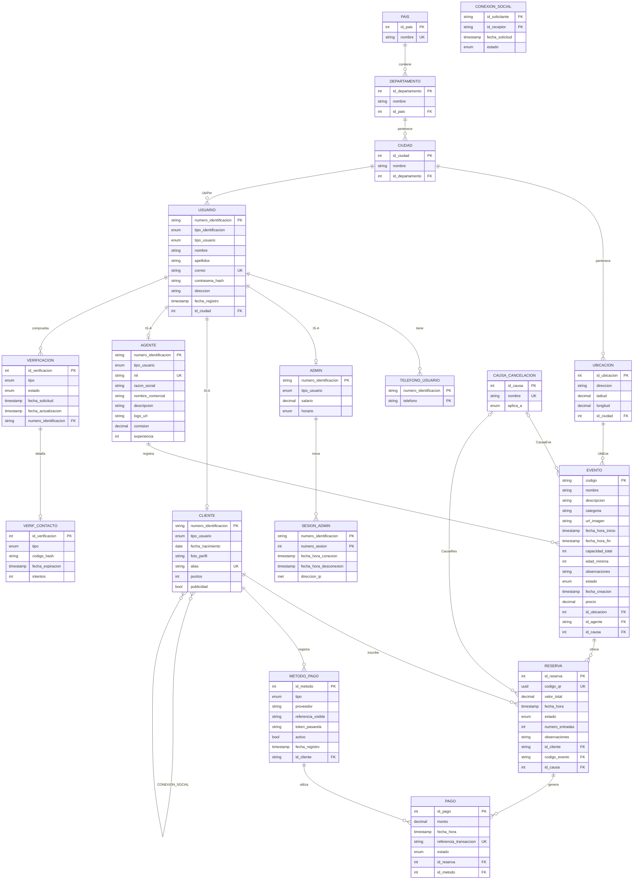

# Modelo relacional — ElDesparche v2 (18 tablas)

Fuente de verdad: `Diagrama_v2.drawio`. Detalle y normalización: `Modelo_Relacional_3FN_Diagrama_v2.docx`.
Esquema SQL: `database/schema_ElDesparche.sql`. Datos de prueba: `database/seed.sql`.

## Decisiones del modelo

- **Herencia total y disjunta** USUARIO → ADMIN / CLIENTE / AGENTE: columna `tipo_usuario` y FK compuesta en cada subtipo; un trigger diferido exige que cada usuario tenga su fila de subtipo.
- **Verificación**: relación 1:1 `Detalla` entre VERIFICACION y VERIF_CONTACTO.
- **Cancelaciones**: `CAUSA_CANCELACION` es un catálogo; EVENTO y RESERVA guardan `id_causa` (nulo salvo cuando están cancelados).
- **Derivados no almacenados**: `edad` (de `fecha_nacimiento`) y `tiempo_en_pantalla` (de las dos fechas de la sesión).
